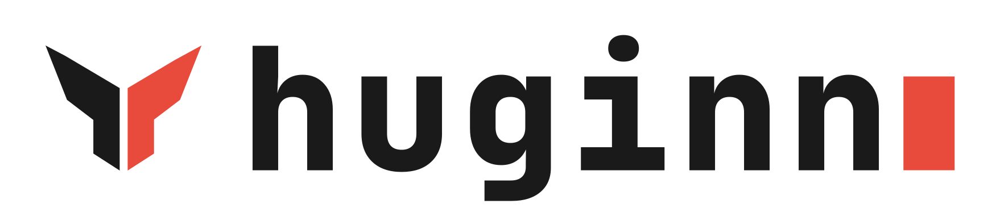

## Huginn — Visual Identity Guidelines

**Working edition 1.2 · 21 November 2026**  
For design, documentation, developer experience, frontend, maintainers and contributors.

## 01 / Brand at a glance

Huginn is a plugin-first coding agent for developers extending and operating agent workflows. Its visual identity is precise, adaptable and deliberately geometric. Huginn and Rook are separate products in the Cortex ecosystem. They share a restrained palette and supporting typography, with distinct marks. See [Cortex brand foundations](../brand-foundations.md) and the [brand index](../README.md).

Use **Huginn** in prose and **HUGINN** where a layout calls for all caps. The artwork uses the lowercase wordmark **huginn**. “Coding agent” and “plugin-first coding agent” are descriptors for surrounding copy.

## 02 / Marks and source files

The [Affinity master](./huginn-identity.af) is the editable source. The [brand sheet](./exports/assets/huginn-brand-sheet.png) brings together the light and dark applications, the icon and the palette. **05 – Master Logo** contains the horizontal lockup.

- **Isotype.** Two faceted wings flank a vertical gap. Charcoal appears on the left against light backgrounds, Ivory on the left against dark backgrounds, and Coral on the right in both.
- **Wordmark.** The lowercase lettering from the supplied JetBrains Mono ExtraBold artwork is converted to paths. The Coral cursor is part of the wordmark.
- **Horizontal lockup.** The default full mark combines the isotype on the left and the outlined wordmark and cursor on the right.
- **Vertical lockup.** Use the supplied stacked asset when the format is too narrow for the horizontal lockup.
- **App icon.** Use the isotype on the rounded Charcoal tile. The 32 px version opens the channel between the wings so it remains visible at that size.

### Components in Affinity

The **isotype** and **full lockup** are linked symbols. The full lockup contains an instance of the isotype. An edit to a wing updates both standalone isotypes and full lockups. Adjust the relationship between the emblem, lettering and cursor inside the full lockup when changing the master composition. The wordmark alone is available as an export and remains editable as paths within the full lockup. Affinity’s current applications include the primary master, variations, monochrome examples, stationery and mockups.

### Export inventory

| Asset                       | SVG                                                           | PNG                                                           |
|-----------------------------|---------------------------------------------------------------|---------------------------------------------------------------|
| Horizontal lockup on light  | [SVG](./exports/assets/huginn-lockup-horizontal-light-bg.svg) | [PNG](./exports/assets/huginn-lockup-horizontal-light-bg.png) |
| Horizontal lockup on dark   | [SVG](./exports/assets/huginn-lockup-horizontal-dark-bg.svg)  | [PNG](./exports/assets/huginn-lockup-horizontal-dark-bg.png)  |
| Vertical lockup on light    | [SVG](./exports/assets/huginn-lockup-vertical-light-bg.svg)   | [PNG](./exports/assets/huginn-lockup-vertical-light-bg.png)   |
| Vertical lockup on dark     | [SVG](./exports/assets/huginn-lockup-vertical-dark-bg.svg)    | [PNG](./exports/assets/huginn-lockup-vertical-dark-bg.png)    |
| Standalone isotype on light | [SVG](./exports/assets/huginn-isotype-light-bg.svg)           | [PNG](./exports/assets/huginn-isotype-light-bg.png)           |
| Standalone isotype on dark  | [SVG](./exports/assets/huginn-isotype-dark-bg.svg)            | [PNG](./exports/assets/huginn-isotype-dark-bg.png)            |
| Monochrome isotype, black   | [SVG](./exports/assets/huginn-isotype-mono-black.svg)         | [PNG](./exports/assets/huginn-isotype-mono-black.png)         |
| Monochrome isotype, white   | [SVG](./exports/assets/huginn-isotype-mono-white.svg)         | [PNG](./exports/assets/huginn-isotype-mono-white.png)         |
| Wordmark on light           | [SVG](./exports/assets/huginn-wordmark-light-bg.svg)          | [PNG](./exports/assets/huginn-wordmark-light-bg.png)          |
| Wordmark on dark            | [SVG](./exports/assets/huginn-wordmark-dark-bg.svg)           | [PNG](./exports/assets/huginn-wordmark-dark-bg.png)           |
| App icon, 1024 px           | [SVG](./exports/assets/huginn-app-icon.svg)                   | [PNG](./exports/assets/huginn-app-icon.png)                   |
| App icon, 32 px             | [SVG](./exports/assets/huginn-app-icon-32.svg)                | [PNG](./exports/assets/huginn-app-icon-32.png)                |
| Brand sheet                 | [SVG](./exports/assets/huginn-brand-sheet.svg)                | [PNG](./exports/assets/huginn-brand-sheet.png)                |

The current delivery lives in [exports](./exports/). It contains **26 assets** and **34 presentation files** in [artboards](./exports/artboards/), one SVG and one PNG for each of the 17 Affinity artboards.

## 03 / Geometry and placement

Preserve the wing angles, central gap and lower profile. Assess the balance of the two wings visually. Scale the supplied artwork uniformly, using its visible bounds for alignment. Keep the cursor attached to the wordmark and use the supplied lockups for their spacing and proportions.

**Provisional clear space.** Allow at least one quarter of the visible isotype height on all sides. Measure from the artwork rather than the edges of the transparent canvas.

**Sizing.** The Affinity comparison includes an 80 px standalone isotype and a 160 px horizontal lockup. These are reviewed samples. For deployment, start at 180 CSS px for the full horizontal lockup and 220 px for a documentation masthead where there is room. At 32 px, use the dedicated app icon. The 16 and 24 px favicon sizes still need testing in the target browser and OS.

## 04 / Palette

| Color    | HEX       | RGB             | Use                                                          |
|----------|-----------|-----------------|--------------------------------------------------------------|
| Charcoal | `#1A1A1A` | `26, 26, 26`    | Left wing and lettering on light backgrounds, dark icon tile |
| Ivory    | `#F7F5F2` | `247, 245, 242` | Light surfaces and the light elements of inverse marks       |
| Coral    | `#E84A3C` | `232, 74, 60`   | Right wing and cursor                                        |

The current Huginn and Rook artwork share Coral. Use the inverse artwork on dark backgrounds. Use Charcoal for small copy on Ivory. Keep the brand accent independent of agent state, notifications and error colors. Select CMYK or spot equivalents with the print provider using the intended profile and a proof.

## 05 / Product typography

Use the [shared Cortex typography](../brand-foundations.md#typography--selected-for-product-interfaces-2026-11-02) for interface text, documentation and technical content. Huginn’s outlined wordmark remains part of its own vector artwork.

## 06 / Applications and voice

- **Repository and docs.** Use the horizontal lockup at the masthead and the isotype where the product name already appears.
- **Website.** Match the lockup to the background and keep explanatory copy outside the artwork.
- **App and repository avatars.** Use the square app icon. Check rendering against the platform’s own crop and background.
- **CLI/TUI.** Use the plain name `Huginn` when the interface cannot display an image.
- **Stationery and mockups.** Use the full lockup where there is enough width. Use the isotype on narrow or compact surfaces. The [mockups](./exports/artboards/11-mockups.png) and [stationery](./exports/artboards/10-stationery.png) show both uses.
- **Voice.** Write directly about extensibility and developer workflows. Keep descriptions of product behavior, capabilities and constraints specific.

Avoid stretching or tilting the artwork, closing the central gap, independently resizing a wing, replacing the outlined wordmark with typed text, or applying decorative effects. Keep each product’s own symbol in its lockups.

## 07 / Handoff and review

The 17 artboards were reviewed in Affinity and exported as SVG and PNG. Synchronization was tested across **17 full-lockup instances** and **25 isotype instances**, including nested isotypes. The 32 px icon was checked at its actual output size for a visible central gap. Some presentation SVGs contain rasterized Affinity effects. Use the standalone SVGs from the asset table for scalable implementations.

For future revisions, edit the linked symbols in the Affinity master, check both light and dark compositions, and replace the relevant SVG and PNG as a pair. Check the artwork at its target size before deployment. Production checks for favicon sizes below 32 px, print proofs and trademark screening remain open.
