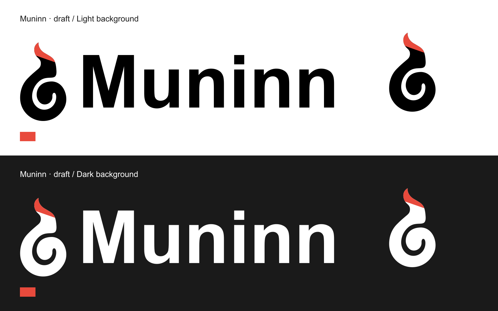

## Muninn — Working visual identity

The [Affinity draft](./muninn-identity.af) contains the isotype, wordmark and horizontal lockup. The full lockup contains an instance of the linked isotype. The study uses a black or white body with Coral `#E84A3C` on the tip of the flame. The provisional lettering is outlined. The standalone reference and earlier color placement study are retained in Affinity.

The flame follows the supplied `human-soul` SVG reference. The proposed mark and usage rights remain under review. Use this kit for design review.

## Export inventory

| Asset                       | SVG                                                           | PNG                                                           |
|-----------------------------|---------------------------------------------------------------|---------------------------------------------------------------|
| Horizontal lockup on light  | [SVG](./exports/assets/muninn-lockup-horizontal-light-bg.svg) | [PNG](./exports/assets/muninn-lockup-horizontal-light-bg.png) |
| Horizontal lockup on dark   | [SVG](./exports/assets/muninn-lockup-horizontal-dark-bg.svg)  | [PNG](./exports/assets/muninn-lockup-horizontal-dark-bg.png)  |
| Vertical lockup on light    | [SVG](./exports/assets/muninn-lockup-vertical-light-bg.svg)   | [PNG](./exports/assets/muninn-lockup-vertical-light-bg.png)   |
| Vertical lockup on dark     | [SVG](./exports/assets/muninn-lockup-vertical-dark-bg.svg)    | [PNG](./exports/assets/muninn-lockup-vertical-dark-bg.png)    |
| Standalone isotype on light | [SVG](./exports/assets/muninn-isotype-light-bg.svg)           | [PNG](./exports/assets/muninn-isotype-light-bg.png)           |
| Standalone isotype on dark  | [SVG](./exports/assets/muninn-isotype-dark-bg.svg)            | [PNG](./exports/assets/muninn-isotype-dark-bg.png)            |
| Monochrome isotype, black   | [SVG](./exports/assets/muninn-isotype-mono-black.svg)         | [PNG](./exports/assets/muninn-isotype-mono-black.png)         |
| Monochrome isotype, white   | [SVG](./exports/assets/muninn-isotype-mono-white.svg)         | [PNG](./exports/assets/muninn-isotype-mono-white.png)         |
| Wordmark on light           | [SVG](./exports/assets/muninn-wordmark-light-bg.svg)          | [PNG](./exports/assets/muninn-wordmark-light-bg.png)          |
| Wordmark on dark            | [SVG](./exports/assets/muninn-wordmark-dark-bg.svg)           | [PNG](./exports/assets/muninn-wordmark-dark-bg.png)           |
| App icon, 1024 px           | [SVG](./exports/assets/muninn-app-icon.svg)                   | [PNG](./exports/assets/muninn-app-icon.png)                   |
| App icon, 32 px             | [SVG](./exports/assets/muninn-app-icon-32.svg)                | [PNG](./exports/assets/muninn-app-icon-32.png)                |
| Brand sheet                 | [SVG](./exports/assets/muninn-brand-sheet.svg)                | [PNG](./exports/assets/muninn-brand-sheet.png)                |

[Artboards](./exports/artboards/) contains the 17 presentation sheets in SVG and PNG. The [master logo](./exports/artboards/05-master-logo.png) and [size comparison](./exports/artboards/05-bis-comparativa-del-logo.png) show the draft applications.

Use the [shared Cortex brand foundations](../brand-foundations.md) for supporting typography, family palette and export conventions.
