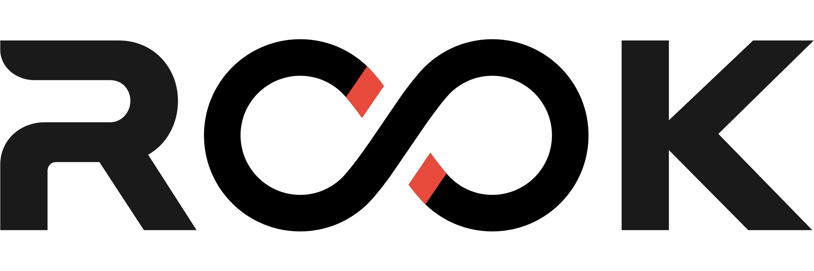

## ROOK — Visual Identity Guidelines

**Brand manual · Working edition 1.2 · 21 November 2026**  
**For:** design, documentation, marketing, frontend, maintainers and contributors.

The [Affinity master](./rook-identity.af) contains the working vector identity. Review gates for production use are listed below.

## 01 / Brand at a glance

| Field                | Definition                                                                | Status              |
|----------------------|---------------------------------------------------------------------------|---------------------|
| Name                 | **ROOK** (uppercase in brand lockups)                                     | CURRENT             |
| Product              | Open-source, Rust-based **AI Gateway**                                    | DOCUMENTED          |
| Purpose              | A unified interface for sending requests to multiple LLM providers        | DOCUMENTED          |
| Capabilities         | Provider routing, fallback/resilience, caching, observability and audit   | DOCUMENTED          |
| Primary audience     | Software engineers, platform/backend teams and infrastructure maintainers | WORKING POSITIONING |
| Identity concept     | **OO Flow / Orchestration**                                               | SELECTED            |
| Visual family        | CORTEX / **Modular Systems**                                              | ACCEPTED            |
| Preferred background | Ivory `#F7F5F2`                                                           | PROPOSED USE        |

**Positioning sentence (WORKING COPY):** ROOK is the gateway between applications and AI model providers—built to make provider choice and resilient request handling manageable.

**Personality (PROPOSED):** precise, dependable, efficient, calm. The brand should feel like infrastructure you can trust rather than a consumer chatbot.

### Architecture of the family

ROOK is an independently branded product in the CORTEX monorepo/ecosystem. HUGINN is a separate coding agent. They share a restrained palette and a disciplined visual tone but **do not share a symbol**. The CORTEX umbrella logotype is deferred. Never place a CORTEX mark inside the ROOK primary logo.

## 02 / Logo identity and meaning

### Primary wordmark

The wordmark comprises **R + connected OO + K**. The pair of O letterforms forms a continuous, infinity-like flow; its **two coral terminals** locate the hand-off/transition inside this form. The R and K anchor the four-letter name. The intended reading remains **ROOK**, not `R∞K` or `R8K`.

**Mandatory preservation rules:**

- Keep the distinctive **OO continuity**, both loop counterforms, R and K proportions, and coral terminal positions intact.
- Use the linked infinity from the master. Use the standalone isotype where the application calls for it.
- Keep the artwork's native orientation and aspect ratio. Avoid manual kerning by moving the individual paths unless a newly reviewed master replaces the current source.
- Do not add a chess tower, circuit traces, arrows, shields, or a generic AI sparkle.

### Current mark family

| Asset                       | SVG                                                         | PNG                                                         |
|-----------------------------|-------------------------------------------------------------|-------------------------------------------------------------|
| Horizontal lockup on light  | [SVG](./exports/assets/rook-lockup-horizontal-light-bg.svg) | [PNG](./exports/assets/rook-lockup-horizontal-light-bg.png) |
| Horizontal lockup on dark   | [SVG](./exports/assets/rook-lockup-horizontal-dark-bg.svg)  | [PNG](./exports/assets/rook-lockup-horizontal-dark-bg.png)  |
| Vertical lockup on light    | [SVG](./exports/assets/rook-lockup-vertical-light-bg.svg)   | [PNG](./exports/assets/rook-lockup-vertical-light-bg.png)   |
| Vertical lockup on dark     | [SVG](./exports/assets/rook-lockup-vertical-dark-bg.svg)    | [PNG](./exports/assets/rook-lockup-vertical-dark-bg.png)    |
| Standalone isotype on light | [SVG](./exports/assets/rook-isotype-light-bg.svg)           | [PNG](./exports/assets/rook-isotype-light-bg.png)           |
| Standalone isotype on dark  | [SVG](./exports/assets/rook-isotype-dark-bg.svg)            | [PNG](./exports/assets/rook-isotype-dark-bg.png)            |
| Monochrome isotype, black   | [SVG](./exports/assets/rook-isotype-mono-black.svg)         | [PNG](./exports/assets/rook-isotype-mono-black.png)         |
| Monochrome isotype, white   | [SVG](./exports/assets/rook-isotype-mono-white.svg)         | [PNG](./exports/assets/rook-isotype-mono-white.png)         |
| Wordmark on light           | [SVG](./exports/assets/rook-wordmark-light-bg.svg)          | [PNG](./exports/assets/rook-wordmark-light-bg.png)          |
| Wordmark on dark            | [SVG](./exports/assets/rook-wordmark-dark-bg.svg)           | [PNG](./exports/assets/rook-wordmark-dark-bg.png)           |
| App icon, 1024 px           | [SVG](./exports/assets/rook-app-icon.svg)                   | [PNG](./exports/assets/rook-app-icon.png)                   |
| App icon, 32 px             | [SVG](./exports/assets/rook-app-icon-32.svg)                | [PNG](./exports/assets/rook-app-icon-32.png)                |
| Brand sheet                 | [SVG](./exports/assets/rook-brand-sheet.svg)                | [PNG](./exports/assets/rook-brand-sheet.png)                |

In Affinity, **rook** is the full logo symbol with the linked infinity inside. Use **rook · Isotipo** when the infinity stands alone. Editing the infinity’s content updates both applications. An edit to the R/K composition updates the full-logo instances. The master logo, variations, monochrome, stationery and mockups use these symbols.

## 03 / Logo layout and spacing

### Recommended lockups

The integrated wordmark is used in both the wordmark and horizontal export slots. The vertical layout stacks the standalone infinity above that wordmark.

- **Primary:** ROOK horizontal wordmark alone.
- **Secondary, if context requires:** the wordmark accompanied by the descriptor **AI Gateway**, set outside the protected logo geometry; descriptor is not part of the master mark.
- **Compact:** the extracted OO mark in a square app icon, not as a substitute for the wordmark on first encounter.

### Clear space — PROVISIONAL engineering rule

Until measured from the final approved vector, reserve at least **0.25 × the visible height of the logo artwork** on **every side**, free of other logos, text, borders and controls. Apply this to the outer visible pixels of the wordmark, not the PNG canvas edge; generated files can include transparent padding. For app icons, rely on the actual icon master and platform safe-zone rules instead.

No fixed trademark clear-space constant or final construction grid has been approved.

### Minimum size — PROVISIONAL, conservative defaults

| Context                 | Working recommendation                           | Status            |
|-------------------------|--------------------------------------------------|-------------------|
| Website/header wordmark | Prefer **≥ 160 CSS px** wide                     | NOT YET VALIDATED |
| Docs/README wordmark    | Prefer **≥ 200 px** rendered width               | NOT YET VALIDATED |
| Standalone OO icon      | Use **≥ 32 × 32 px** until tests approve smaller | NOT YET VALIDATED |
| 16/24 px favicon        | **HOLD** until native-size review                | OPEN GATE         |

These are **usage guidelines, not findings from performed optical tests**. No claim is made that the loop terminals survive at 16 px.

## 04 / Color system

| Brand token  | HEX       | RGB             | Typical role                                   |
|--------------|-----------|-----------------|------------------------------------------------|
| **Charcoal** | `#1A1A1A` | `26, 26, 26`    | Wordmark, structural elements, dark background |
| **Ivory**    | `#F7F5F2` | `247, 245, 242` | Light brand surface, inverse logo components   |
| **Coral**    | `#E84A3C` | `232, 74, 60`   | Small, meaningful accents at OO hand-offs      |

**Recommended pairs:** Charcoal artwork on Ivory; approved inverse artwork on Charcoal. The logo **must remain comprehensible without Coral** if a true monochrome asset is eventually approved. Do not recolor individual pieces according to UI semantic states (warning, error, success).

**Accessibility:** Coral on Ivory does **not** satisfy WCAG AA normal-text contrast; do not use it for small body copy or navigational text on Ivory. The colored logo itself is not a substitute for accessible adjacent text. UI status colors and TUI 256-color fallbacks are separate from brand identity specifications.

**Color modes:** RGB/HEX defined here. **CMYK/Pantone are not specified or approved**. Obtain professional prepress conversions and proofs before commercial printing.

## 05 / Lettering and supporting typography

The R, infinity and K are vector artwork. Use the linked symbols and maintain the spacing and proportions in the master. The [shared brand foundations](../brand-foundations.md#typography--selected-for-product-interfaces-2026-11-02) define supporting type, font stacks, fallbacks and terminal behavior for the family.

## 06 / Supporting design language

- Prefer real product UI, architecture illustrations and documentation diagrams over AI-generated abstract technology imagery.
- Favor clear alignment, intentional whitespace, limited graphic primitives and code demonstrations that represent implemented features.
- Coral can highlight an **active routing decision / hand-off**, but avoid scattering it across all visual elements.
- Separate actual API diagrams from the brandmark; the logo must **not** look like a workflow diagram.
- Avoid gradient 3D cubes, random circuit patterns, artificial lens effects and gratuitous shadows.

## 07 / Correct application examples

| Surface                     | Recommended treatment                                                    | Asset                                                   |
|-----------------------------|--------------------------------------------------------------------------|---------------------------------------------------------|
| GitHub README               | Primary wordmark near introduction, not in a visual collage              | `rook-lockup-horizontal-light-bg.png`                   |
| Documentation masthead      | Primary wordmark with generous negative space                            | `rook-lockup-horizontal-light-bg.png` or QA-cleared SVG |
| Website navigation          | Horizontal wordmark and readable separate CTA                            | QA-cleared SVG                                          |
| CLI banner                  | Prefer textual `ROOK`; display logo image only in media-capable contexts | Text or verified image                                  |
| Application launcher        | Standalone OO on a solid background                                      | App icon, pending 16–32 px tests                        |
| Social preview (1200 × 630) | Wordmark, concise positioning copy, generous whitespace                  | Compose from master source                              |

**Examples are recommendations, not a claim that a marketing kit was delivered or that all formats were tested.** SVG files must not be modified with ad hoc scaling that distorts their `viewBox`.

## 08 / Incorrect usage

Do **not**:

1. Stretch, rotate, skew or perspective-warp the logo.
2. Substitute a font for the outline wordmark.
3. Change OO geometry, accent length/placement, internal gaps, or position of R/K.
4. Turn the OO into a generic infinity mark that lacks the selected glyph proportions.
5. Apply gradients, gloss, bevels, glow, drop shadows or 3D extrusion.
6. Recolor the logo with arbitrary provider or status colors.
7. Place it on a photographic or busy surface without controlled contrast.
8. Put a third-party product or CORTEX logo inside the ROOK mark.
9. Use an old exploratory R1–R20 concept in place of the selected design.
10. Label the logo as trademark-cleared or print-certified without verification.

## 09 / Brand voice and naming

**Tone (PROPOSED):** concise, technical, confident without hype. Explain operational benefits and constraints plainly. Keep claims concrete and testable; avoid invented performance promises.

- Product display name: **ROOK** in branded headlines; `Rook` is acceptable in natural prose if house style requires it.
- CLI/package names and examples should follow the **actual repository conventions**, not stylized logo casing.
- Good descriptor: **AI Gateway**. Longer explanation: **Open-source AI gateway for multi-provider routing and resilience** (working descriptive copy).
- Avoid calling ROOK a chatbot, an LLM, or the complete CORTEX platform.

## 10 / Delivery and technical handoff

**Artifact inventory:** see [Cortex brand index](../README.md), [shared brand foundations](../brand-foundations.md), [current assets](./exports/assets/) and [17 artboards](./exports/artboards/), each in SVG and PNG.

**Export requirements for any future final master:**

- SVG: geometry as paths; correct `viewBox`; no external fonts, `<image>` bitmaps, remote assets, filters, scripts or unnecessary clipping masks.
- PNG: transparent, color-managed export from a reviewed master; 1×/2× assets for each target context.
- Light and dark: tested against actual backgrounds; black-on-black or disappearing charcoal regions are unacceptable.
- Icon: explicit square safe zone; raster review at 16, 24, 32, 64, 128 and 512 px.
- Accessibility: image text alternatives describe product and role; decorative repeats use empty alt text where appropriate.
- Reproducibility: store version/date, reference PNG, vector master and test evidence together; **do not silently regenerate**.

### Open QA / sign-off gates

- [x] Check the primary mark and linked symbol behavior in Affinity at 1:1 and 160 px.
- [ ] Inspect the OO counterforms and two Coral terminals on light/dark backgrounds.
- [ ] Run independent icon legibility tests at 16/24/32/64 px; update min size only on evidence.
- [ ] Approve the single-color and inverse assets explicitly.
- [ ] Establish typography licenses and a reproducible supporting type system.
- [ ] Screen current trademarks and visual collisions, especially the independent CNCF Rook project.
- [ ] Obtain final production identity sign-off and mark this guide `ACCEPTED`.

**Current status:** `WORKING_GUIDELINES / AFFINITY_REVIEWED`.

---

*The master and export directory record the current working identity.*
